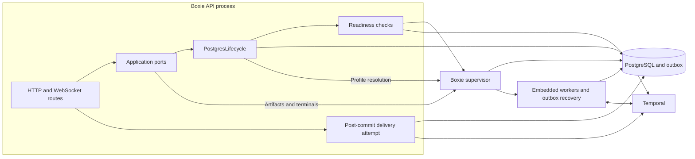
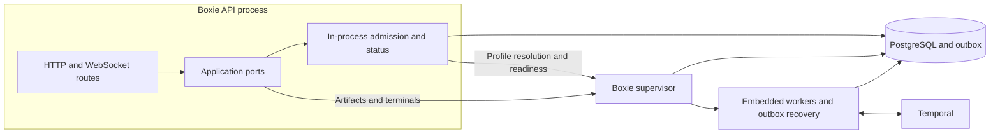

# Boxie admission boundary decision

Keep admission inside the Boxie API process, behind the existing `Lifecycle`,
`ReadyLifecycle` and `JobAccess` ports. PostgreSQL remains the authority for
acceptance and accounting. `PostgresLifecycle` already implements these ports
and owns the single transaction that accepts a terminal or job. A separate
admission deployment would add a network hop where a reply could be lost
after commit. It would still need the same transaction. The [admission
investigation](https://github.com/di-rs/sanctuary/issues/73) and the [platform
audit](https://github.com/di-rs/sanctuary/pull/320) define the scope.

## Responsibilities and dependencies

| Owner | Responsibility |
| --- | --- |
| API transport | Resolve the consumer principal from its credential, validate the wire request, and invoke the application port. Limit result downloads in the API process. For terminal attachment, check SQL ownership before relaying the connection to the supervisor. |
| API admission and status | Apply consumer job grants, preserve the idempotency contract, commit acceptance or stop intent, and serve consumer-scoped status and results from PostgreSQL. |
| Supervisor | Resolve operator-owned profiles, exact job commands, limits and lifetimes. Own artifact bytes and collection, Docker, PTYs, the local journal, and the final execution fence. |
| Supervisor workers | Recover pending outbox commands, project fenced observations into SQL, settle interrupted job receipts, and purge settled history. |

The current API bootstraps PostgreSQL sessions, an authenticated supervisor
client, and a lazy Temporal client. It uses Temporal for readiness, diagnostics
and an optional one-second delivery attempt after the SQL operation returns.
The supervisor already owns durable recovery. The [dispatch
decision](https://github.com/di-rs/sanctuary/pull/353) under [issue
#72](https://github.com/di-rs/sanctuary/issues/72) keeps the API attempt until
the supervisor meets the delivery latency and readiness gates. The admission
transaction and SQL reads work with either delivery path. See the
[API wiring](../src/boxie/bootstrap/api.py) and
[outbox dispatcher](../src/boxie/temporal/dispatcher.py).

## Transaction boundaries

**Submit.** Both submission ports normalize the request and hash it. The
`READ COMMITTED` transaction takes a PostgreSQL advisory lock on the consumer
and idempotency key, then checks the request hash in the retained job receipt
or sandbox row. A matching retry returns the existing ID and reads its current
view, even after profile, grant, readiness or artifact-retirement changes.
A conflicting request, including reuse of the same key across terminal and
job submissions, returns 409. Job keys survive result expiry and sandbox
retention cleanup. Terminal keys live with the retained sandbox.

For a new key, the API checks the consumer's job profile grant and admission
readiness, then asks the supervisor to resolve the approved snapshot. The
idempotency lock stays held across these bounded dependency calls. Readiness
includes supervisor health, Temporal health, namespace, pollers and schedules,
plus the database-wide count and oldest age of pending start and stop commands.
The transaction locks the artifact row shared with retirement and checks
ownership and retirement state. For jobs, it then takes the shared job-output
advisory lock and checks both the consumer and installation budgets. Finally
it claims an available capacity slot with
`FOR UPDATE SKIP LOCKED`. Insufficient output budget or no claimable slot
returns 429.

One commit writes the sandbox snapshot and deadline, optional job receipt and
output reservation, capacity assignment, artifact reference, and start outbox
event. An outbox insert failure rolls back every write. The response view is
read in a subsequent SQL transaction. If connection loss obscures the commit,
or the view read fails after commit, retry with the same key and request. A
database availability error can return 503, and the API leaves the retry to
the caller. Outbox send and acknowledgement happen after commit. A lost
acknowledgement can redeliver the event. Delivery uses a stable workflow ID
with a reconcile signal, and execution rechecks the stored intent and fence.
[Transaction implementation](../src/boxie/persistence/postgres.py)

**Stop and read.** A terminal stop locks the consumer's sandbox row, records
the first stop reason and pending cleanup, and inserts a deduplicated stop
event in the same commit. Repeated stops return the existing state. The final
Docker start uses that same row lock around the bounded start call. A stop
committed first prevents start. Sandbox and job reads are owner-scoped SQL
projections. New admissions can return 503 during a Temporal or supervisor
outage, while matching retries, status, retained results and terminal stop can
still use PostgreSQL. Accepted-job cancellation is a separate
[consumer API change](https://github.com/di-rs/sanctuary/issues/37).

**Observations and cleanup.** Applying a supervisor observation locks the
sandbox row and checks the observation version, owner, installation, host,
generation and boot. Confirmed physical removal releases the capacity slot
and artifact reference in the projection transaction. Artifact retirement
blocks new references, and the supervisor collects retired bytes once those
references are gone. A job must commit its single-use start authorization
before its final start check. Completion commits the receipt, result and
actual retained byte count together. Interrupted attempts release unused
output reservations when settled, and completed output remains charged until
expiry cleanup. [Execution and recovery](execution.md) describes the lifecycle
and restart behavior.

## Scope of a future change

An in-process service can separate pure policy from SQL if another caller needs
it or the policy develops enough independent behavior to justify extraction.
Keep the existing policy types and resolver. If extraction is warranted, keep
one admission method that owns the session and all writes. Start with an
execution-side interface for request loading, boot binding, observations and
retention if callers need to evolve those operations independently. Separate
repository calls that each commit would let a partial acceptance leak capacity
or strand work without an outbox event.

The recommended dependency direction keeps SQL with the API and lets the
supervisor supply execution and dispatch health if the dispatch investigation
validates that change. The API would still use the Boxie application database
credential for commands, status and results, and its supervisor credential
for profiles, artifacts, terminals and readiness. Direct Temporal access
stays in effect until the dispatch change is ready.

Revisit a separate admission deployment if Boxie maintainers can identify an
independent scaling or credential-isolation requirement that the API process
cannot meet. A proposal would need to show that the service owns the entire
transaction, how authenticated caller identity reaches it, and how a caller
recovers the original result when the service commits but its reply is lost.
It would also need an explicit plan for status and stop during service outages.

## Regression and rollback

[PostgreSQL integration coverage](https://github.com/di-rs/sanctuary/pull/326)
adds the missing CI selectors and tests on the deployed PostgreSQL major.
Require that coverage before moving admission code. The [artifact quota
migration](https://github.com/di-rs/sanctuary/pull/333) adds storage accounting
to the supervisor's upload and collection path. Its staging reservations are
independent of admission's artifact references and job-output budget. If both
changes are present in a future refactor, check admission against retirement
and delayed collection on the migrated schema.

Use the [PostgreSQL regressions](../tests/test_postgres.py), [job receipt
tests](../tests/test_job_receipts.py), and [outbox tests](../tests/test_outbox.py)
as the baseline on disposable PostgreSQL. Verify these invariants before
changing the transaction or its callers.

| Scenario | Required result |
| --- | --- |
| Concurrent identical and conflicting keys, including terminal and job requests under the same consumer key | One acceptance and one set of reservations and start event. Identical requests recover the same ID. Conflicting requests receive 409. |
| Outbox insert failure and ambiguous commit acknowledgement | A rejected insert leaves no acceptance, job key, slot, artifact reference or output reservation. A matching retry after an ambiguous acknowledgement resolves the outcome without a second acceptance. |
| Capacity, job-output exhaustion, and artifact retirement racing with admission | Rejected attempts leave accounting intact. Retained output counts against its budget until expiry. Referenced artifacts remain available until physical cleanup is confirmed. |
| Dependency outage, ownership, and stop before start | An outage blocks new keys when admission is unready. With SQL available, matching retries, owner reads and stop still work. Foreign reads and stops are rejected. A stop that takes the sandbox lock first prevents the final start. |
| Supervisor restart and outbox redelivery | Reconcile the retained journal and existing intent, fence stale observations, and release reservations only at their documented completion points. A lost start acknowledgement cannot authorize a second job attempt. |

Reverting this decision changes documentation only. A future in-process
extraction should preserve the HTTP contract, schema, request hashes, and
outbox keys so the previous API build can resume on the same database.
Rehearse rollback with a pending start, a pending stop and a retained job
result. Keep the supervisor consuming the same outbox and keep all keys,
receipts and reservations during rollback.
