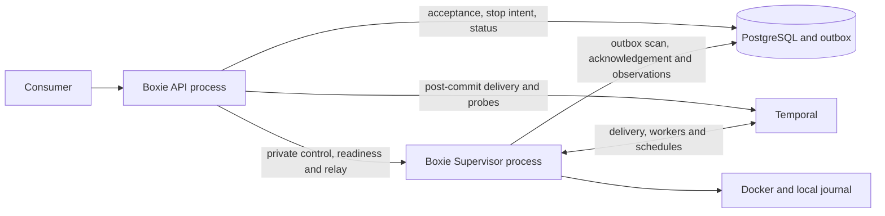
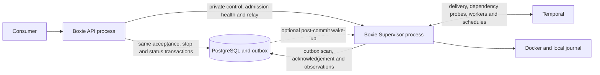

# Boxie dispatch ownership

Use the existing supervisor process as the target for all dispatch. Its recovery
loop already delivers committed commands after API failure. Keep the API fast
path and Temporal configuration until a faster supervisor delivery path meets
consumer latency requirements and supplies equivalent readiness and diagnostics.
This decision covers delivery after commit. [Dispatch investigation #72](https://github.com/di-rs/sanctuary/issues/72) ·
[Admission and transaction investigation #73](https://github.com/di-rs/sanctuary/issues/73) ·
[Cleanup audit #320](https://github.com/di-rs/sanctuary/pull/320)

## Current ownership

Both `boxie-api` and `boxie-supervisor` use [`CommandDelivery`](../src/boxie/temporal/dispatcher.py).
The API waits up to one second to attempt delivery after terminal creation,
terminal stop, or a job submission that returns `queued`. The supervisor scans
its installation and host's pending rows at startup and waits five seconds
after each pass. A pass reads up to 32 rows, uses eight concurrent deliveries and
has a 20-second deadline. The two paths can pick the same row. A failed attempt
leaves committed acceptance or stop intent in SQL. New installations schedule
artifact and retention cleanup. The legacy commands activity can still finish
maintenance runs already started. [API routes](../src/boxie/api/routes.py) ·
[Worker startup](../src/boxie/bootstrap/workers.py) · [Maintenance](execution.md#native-maintenance)

The lazy API Temporal client lets the API start during a Temporal outage if its
TLS files are readable. New admission and `/readyz` check server health, namespace,
lifecycle workflow and activity pollers, and the required cleanup schedules.
They also require a ready supervisor and a SQL backlog below 100 pending commands
with the oldest at most 30 seconds old. Supervisor readiness covers its execution
state, Docker and PostgreSQL. The API's background metrics independently probe
Temporal, the namespace and all four lifecycle and maintenance pollers. Poller
access within 90 seconds counts as evidence of recent presence.
[API bootstrap](../src/boxie/bootstrap/api.py) ·
[Readiness probes](../src/boxie/bootstrap/dependencies.py) ·
[Dependency metrics](../src/boxie/observability/process.py)

The API and supervisor mount separate Temporal mTLS keypairs. Each admitted
client has cluster-wide authority because the server uses a no-op authorizer.
The API's Temporal identity is distinct from its supervisor-control and
consumer credentials. [Temporal trust](temporal.md#trust-and-private-transport) ·
[Credential configuration](configuration.md)

## Measured delivery latency

Measurements at `65a9ef34` used loopback HTTP on Apple Silicon macOS, the
`boxie-api` bootstrap, and a separate supervisor process with real embedded
workers and Boxie's test Docker adapter. Disposable Linux containers ran
PostgreSQL 18.6 and Temporal 1.32.2 with mTLS. The supervisor-only probe set
`deliver=None` when constructing the HTTP app and kept the API's readiness checks.

The start timestamp is the commit of the outbox insert in the acceptance or
stop transaction. The end timestamp is the commit of its delivery acknowledgement.
Both came from PostgreSQL commit tracking in the disposable database. Healthy
samples submitted and stopped terminals serially with an empty backlog, and
verified the matching `reconcile` signal in Temporal history. Supervisor-only
requests sampled five offsets from 0.25 to 4.25 seconds after an empty scan.

| Delivery path | Samples per operation | Start median (range) | Stop median (range) |
| --- | ---: | ---: | ---: |
| Current API attempt plus supervisor recovery | 5 | 12.3 ms (10.2–26.6 ms) | 8.8 ms (7.8–10.9 ms) |
| Supervisor polling alone | 5 | 2.72 s (0.78–4.73 s) | 2.75 s (0.76–4.78 s) |
| Supervisor killed and replaced, API callback omitted | 1 | 2.69 s | 2.62 s |

For the restart sample, the probe killed the supervisor before it could see two
new start rows. The API stayed up and served status, returned the original ID on
a matching retry, rejected a fresh request with 503, and recorded stop intent
for one pending sandbox. After a deliberate two-second hold, a new supervisor
boot acknowledged the accepted start and the stop. One sandbox became ready and the
other reached `terminated` with cleanup settled.

These samples measure delivery to Temporal. Provisioning, terminal attach and
resource removal have their own latencies. A busy pass, a failed RPC or an
outage can delay the next scan beyond five seconds. Use the measurements to
compare paths locally. Approve a latency budget with the playground and job
consumers before using them to make a production cutover decision.

## Failure and recovery behavior

| Situation | Consumer and operator behavior |
| --- | --- |
| API stops after SQL commit | The supervisor scans independently. Matching submissions recover the original ID. SQL owns status and stop intent. |
| Temporal unavailable | With PostgreSQL available, the API serves status, matching retries and terminal stop. New admission fails readiness. Pending commands remain in SQL and retry when delivery recovers. The running supervisor still enforces local deadlines. A fresh supervisor boot needs Temporal to start embedded workers and verify schedules. |
| Supervisor unavailable or restarting | New admission fails readiness. SQL can still expose accepted work and record terminal stop. The replacement supervisor reconciles its journal and starts a scan after worker and schedule setup. Existing PTYs end on restart. |
| Duplicate delivery or lost acknowledgement | Both paths signal-with-start using `boxie/sandbox/<id>`. An open workflow is reused. Each signal requests a fresh read of SQL, so repeated signals carry no new authority. Closed workflow IDs are rejected while retained. Delivery acknowledges a settled command without signalling only when SQL confirms cleanup and accounting release. An unexpected closed workflow with outstanding cleanup stays pending for investigation. |
| Stop races with start or cleanup | SQL records stop durably. The start guard checks it under lock. A successful stop response can still have `cleanup_pending`. Uncertain creation or deletion retains capacity and artifact references until the supervisor proves physical absence and SQL records it. Starting a job still requires its one-time authorization after redelivery. |

The existing tests cover a committed command with API delivery omitted, loss of
the SQL acknowledgement after Temporal accepted the signal, a failed recovery
scan, backlog gating, and an actual API process pointed at an unavailable
Temporal address. Native lifecycle tests cover process loss, replay and failed
physical deletion. [Outbox regressions](../tests/test_outbox.py) ·
[Native lifecycle regressions](../tests/integration/test_lifecycle.py) ·
[Execution and recovery](execution.md#embedded-temporal-execution)

## Proposed ownership and cutover

The current polling loop already gives the supervisor sole delivery ownership
when the callback is omitted. A faster bounded poll would reduce idle wait at the
cost of more SQL reads. An in-process relay in the supervisor can instead wake on
PostgreSQL `LISTEN`/`NOTIFY` as a latency optimization. The existing API operation
still commits admission and the outbox row in one transaction. Startup and
periodic scans cover missed wake-ups.
An in-process dispatcher in the API would keep a Temporal credential on the
consumer-facing service and lose its own delivery loop on API restart. A separate
relay would add SQL and Temporal credentials, startup and deployment coordination,
and another failure mode. It would still need the supervisor's execution workers.
Revisit a separate relay only if measured contention or an independent availability
requirement survives tuning and load tests inside the supervisor.

1. Expose authenticated, freshness-bounded orchestration health through the
   supervisor's private control interface. Require the current boot's execution
   readiness, Temporal and lifecycle poller checks, compatible cleanup schedules
   and a recent completed outbox scan, including empty passes. Fail closed on
   stale or missing evidence for new admission. Keep the SQL backlog count and age
   gate and retain the matching-retry, status and terminal-stop paths during
   outages. Keep the API's `/healthz` and `/readyz` response contracts for release
   probes. [Readiness contract](consumer-api.md) · [Release probes](deployment.md)
2. Move Temporal dependency gauges to the supervisor and update dashboards and
   `BoxieWorkerUnavailable` together. Keep known/unknown status, all four poller
   labels, SQL outbox depth and oldest age, and private request correlation.
   Record commit-to-delivery latency for starts and stops. Compare a shorter poll
   or a wake-up against the baseline under concurrent acceptance and restart.
   Verify dropped wake-ups still drain, a paused scan fails new admission, and
   a lost acknowledgement preserves one workflow and one physical start.
   [Observability](observability.md) · [Alert rules](../infra/observability/rules/boxie.yml)
3. In a disposable deployment, switch off the API callback with both paths
   available for rollback. Exercise terminal create, attach, stop and job
   submission under native Linux/gVisor. Include Temporal outages, supervisor
   kills, stop before start, replay and deletion failures. Rehearse the operator
   diagnostics and use the same fixtures for both configurations. Coordinate
   the rollout gate with #73 and the PostgreSQL integration coverage in #326.
4. After the measured latency and parity gates pass, deploy the supervisor
   changes first, then deploy the API without Temporal client construction,
   config fields or TLS mounts. Keep the supervisor and operator identities and
   the API's SQL and private control access. Leave the last working API image
   and config available for a rollback window. Roll back by restoring that API
   and its protected certificate/key mounts and the matching alert rules.
   Pending commands remain in SQL and either delivery path can drain them.
   Retire the API certificate through the operator's credential process after
   rollback is no longer needed. [Deployment configuration](configuration.md)
